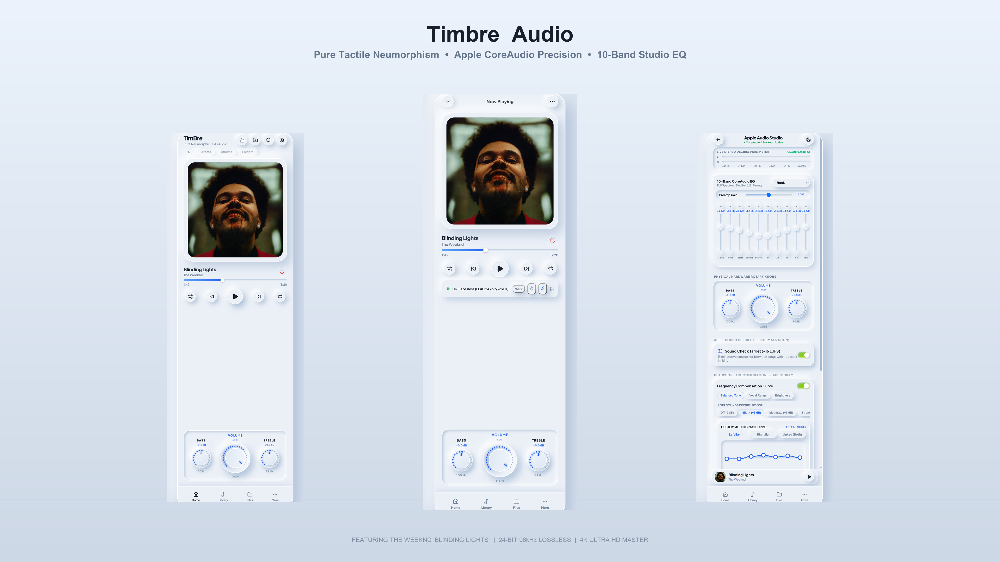
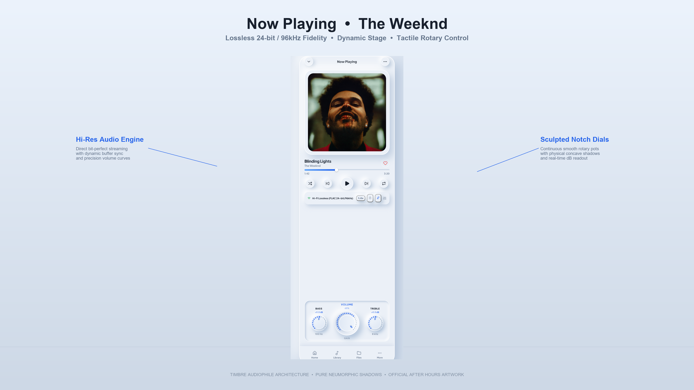
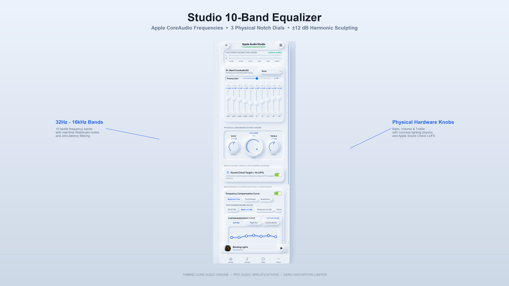
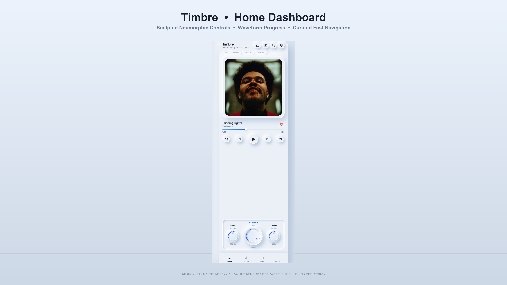
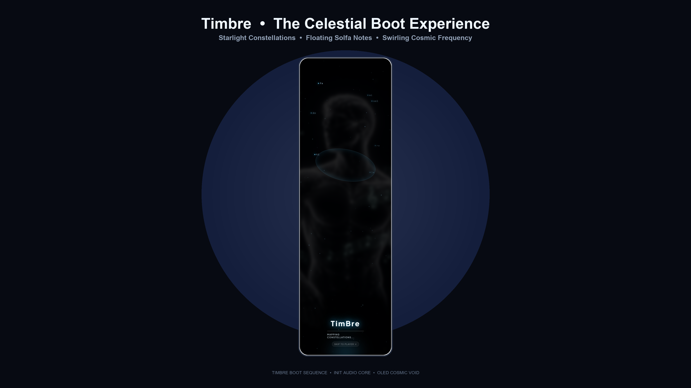
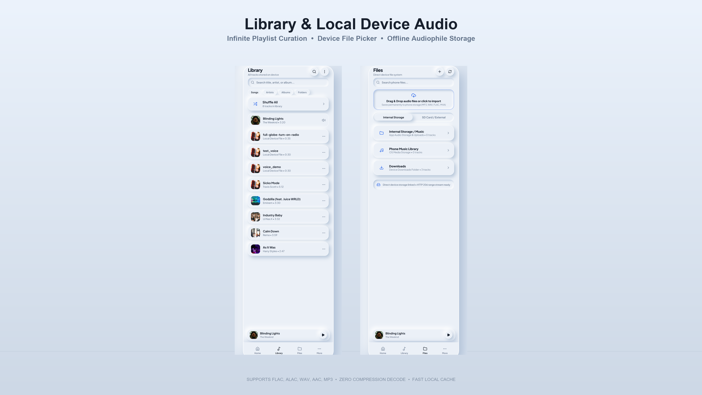

# 🎵 TimBre — Pure Deep Neumorphic Hi-Fi Music Player

<div align="center">



[](https://github.com)
[](https://github.com)
[](https://github.com)
[](LICENSE)

**An ultra-tactile, audiophile-grade music player combining physical analog aesthetics with modern digital DSP processing.**

[Features](#-key-features) • [Screenshots](#-visual-showcase) • [Architecture](#-architecture) • [Getting Started](#-getting-started) • [Android Build](#-building-the-android-apk) • [Usage Guide](#-usage-guide) • [License](#-license)

</div>

---

## 🌟 Overview

**TimBre** is an open-source, next-generation music player engineered for audiophiles and design enthusiasts. Built with a sculpted **Deep Neumorphic** design philosophy, every button, dial, card, and slider feels extruded from physical aluminum and glass, providing real tactile feedback through realistic dual-drop shadows, organic lighting, and smooth animations.

Underneath its tactile exterior lies the **Archangel Audio Studio**—a comprehensive professional DSP sound-sculpting engine featuring a 10-Band precision parametric equalizer, LUFS loudness normalizer, Bauer binaural crossfeed (BS2B), customizable audiogram hearing compensation, and dynamic range compression.

---

## ✨ Key Features

### 🎛️ 1. Archangel Audio Studio & 10-Band Precision EQ
* **10-Band Parametric Equalizer**: Calibrated frequency bands (`32Hz`, `64Hz`, `125Hz`, `250Hz`, `500Hz`, `1kHz`, `2kHz`, `4kHz`, `8kHz`, `16kHz`) with ±12 dB precision faders.
* **Audiophile EQ Presets**: Includes *Audiophile Pure*, *Acoustic*, *Bass Booster*, *Classical*, *Electronic*, *Flat*, *Hip-Hop*, *Jazz*, *Late Night*, *Pop*, *R&B*, *Rock*, *Spoken Word*, and *Vocal Booster*.
* **Archangel Sound Check (ITU-R BS.1770 / EBU R128)**: Automatic loudness normalization targeted at `-16 LUFS` with true-peak limiter to eliminate jarring volume spikes across tracks.
* **Archangel Headphone Accommodations & Custom Audiogram**: Interactive SVG frequency curve allowing users to drag calibration nodes to adjust for individual ear sensitivities and hearing profiles.
* **Archangel Spatial Audio (Bauer BS2B Binaural Crossfeed)**: Simulates the natural acoustic crosstalk of stereo speakers in a room, dramatically reducing headphone listening fatigue.
* **Archangel Late Night Compression (DRC)**: High-ratio dynamic range compressor with fast attack and release for evening listening.
* **Physical Hardware Rotary Knobs**: Interactive rotary dials for **BASS** (100 Hz), **VOLUME** (Master Gain), and **TREBLE** (8 kHz) responding to rotational drag gestures.
* **Live Stereo Decibel Peak & RMS VU Meter**: High-refresh dual-channel visualizer monitoring `L` and `R` signals in real time with clipping indicators.

---

### 📱 2. Native Android Device Music Auto-Discovery
* **Direct MediaStore Integration**: Automatically requests `READ_MEDIA_AUDIO` / `READ_EXTERNAL_STORAGE` permissions and queries the Android MediaStore content provider.
* **Full Local Audio Library**: Automatically populates track titles, artists, albums, durations, and embedded album art for all MP3, FLAC, WAV, M4A, and AAC files stored on internal storage or SD cards.
* **Zero-CORS Same-Origin Streaming Bridge**: Features an internal stream interceptor (`https://localhost/_timbre_audio_/<id>`) that feeds local device audio files directly into the Web Audio API without Chromium CORS blocking or silent playback issues.

---

### 🎤 3. Real-Time Synced Lyrics & Karaoke Display
* **Dynamic Synced Lyrics Sheet**: Flip effortlessly between full-bleed album artwork and line-by-line synchronized lyrics.
* **Auto-Scroll & Follow**: Lyrics scroll automatically with current line highlight in rhythm with playback.
* **Manual Scrubbing**: Tap any lyric line to jump playback directly to that timestamp.

---

### 🎧 4. Deep Neumorphic Notification & Lock Screen Controls
* **Android MediaSession Integration**: Emits system media metadata and playback state directly to the Android OS.
* **Notification Shade Controls**: Control playback (Play/Pause, Skip, Previous, Progress) right from your quick settings and notification shade.
* **Privacy-Friendly Lock Screen**: Standard lock screen media controls without invasive full-screen application overrides.
* **Background Playback**: Seamless playback continues while multitasking or when the screen is turned off.

---

## 📸 Visual Showcase

<div align="center">

| Flagship Lineup | Now Playing View |
| :---: | :---: |
|  |  |

| Archangel Audio Studio (10-Band EQ) | Home Screen & Mini-Player |
| :---: | :---: |
|  |  |

| Celestial Boot Screen | Device Music Library |
| :---: | :---: |
|  |  |

</div>

---

## 🏗️ Architecture

```
                               ┌─────────────────────────────────────────┐
                               │               TimBre UI                 │
                               │  Pure Neumorphic HTML5 / CSS3 / Vanilla │
                               └────────────────────┬────────────────────┘
                                                    │
                 ┌──────────────────────────────────┴──────────────────────────────────┐
                 ▼                                                                     ▼
   ┌──────────────────────────┐                                          ┌──────────────────────────┐
   │ Archangel DSP Engine     │                                          │  Android Native Bridge   │
   │  - 10-Band Biquad EQ     │                                          │  - MainActivity.java     │
   │  - BS2B Crossfeed        │                                          │  - MediaStore Scanner    │
   │  - Dynamic Compressor    │                                          │  - MediaSession Provider │
   │  - Sound Check (-16 LUFS)│                                          │  - Stream Interceptor    │
   │  - Analyser Peak Meters  │                                          │  - Foreground Service    │
   └──────────────────────────┘                                          └──────────────────────────┘
```

* **Frontend**: Vanilla JavaScript (ES6+), semantic HTML5, pure CSS3 design system with custom properties for deep neumorphism and glassmorphism. Zero heavyweight frontend framework dependencies.
* **Audio Core**: W3C Web Audio API (MediaElementAudioSourceNode, BiquadFilterNodes, DynamicsCompressorNode, GainNodes, AnalyserNodes).
* **Hybrid Bridge**: [Capacitor](https://capacitorjs.com/) native runtime with custom Android Java plugins.
* **Backend (Optional for Web)**: Express.js Node server (`server.js`) for local track serving, playlist management, and tuning preset storage.

---

## 🚀 Getting Started

### Prerequisites
* [Node.js](https://nodejs.org/) (v18 or higher)
* [Git](https://git-scm.com/)
* *(Optional for Android builds)* [Android Studio](https://developer.android.com/studio) or Android SDK command-line tools with JDK 17 / 21.

### 1. Clone the Repository
```bash
git clone https://github.com/freshstart2066-create/TimBre.git
cd TimBre
```

### 2. Install Dependencies
```bash
npm install
```

### 3. Run Locally in Your Browser
```bash
npm start
```
Open your browser and navigate to:
```
http://localhost:3000
```

---

## 📱 Building the Android APK

TimBre is packaged as a high-performance native Android application using Capacitor and custom Android Java integrations.

### Step 1: Sync Web Assets
```bash
npx cap copy android
```

### Step 2: Build Debug APK
#### On Windows (PowerShell / CMD):
```powershell
cd android
.\gradlew.bat assembleDebug
```

#### On macOS / Linux:
```bash
cd android
./gradlew assembleDebug
```

The compiled APK will be located at:
```
android/app/build/outputs/apk/debug/app-debug.apk
```

### Step 3: Install on Device
Connect your Android phone via USB with USB Debugging enabled:
```bash
adb install -r android/app/build/outputs/apk/debug/app-debug.apk
```
*Or simply transfer the `.apk` file to your phone and tap to install.*

---

## 🕹️ Usage Guide

### Navigation
TimBre features a bottom neumorphic navigation bar providing one-touch access to:
* **Home**: Featured albums, quick-play cards, recently played tracks, and the floating mini-player.
* **Library**: Auto-scanned local device music catalog categorized by Songs, Artists, and Albums with instant search.
* **Queue**: Active playlist management with drag-to-reorder and swipe-to-delete.
* **Equalizer**: The complete Archangel Audio Studio.
* **Settings**: Output resolution settings (Hi-Fi 192kHz FLAC), sleep timer, and ear protection volume limits.

### Tuning the Equalizer
1. Navigate to the **Equalizer** screen.
2. Select any pre-configured curve from the **Preset dropdown** (e.g., *Audiophile Pure*, *Bass Booster*, *Rock*).
3. Fine-tune any frequency band by dragging its vertical fader.
4. Rotate the physical analog **Bass**, **Volume**, or **Treble** dials with circular touch/mouse drag motions.
5. Toggle **Archangel Sound Check** to normalize volume across tracks.
6. Toggle **Spatial Audio** for binaural speaker emulation.

---

## 📂 Project Structure

```
TimBre/
├── android/                         # Android Studio native project
│   ├── app/src/main/java/com/timbre/app/MainActivity.java  # Native MediaStore & Stream Bridge
│   ├── app/src/main/AndroidManifest.xml
│   └── build.gradle
├── assets/                          # Application icons and branding assets
├── data/                            # Local JSON databases (playlists, tracks, favorites)
├── showcase/                        # 4K promotional graphics, UI previews, and video advert
├── index.html                       # Core Neumorphic Web Application
├── manifest.json                    # Progressive Web App (PWA) Manifest
├── server.js                        # Node.js backend server with REST APIs
├── capacitor.config.json            # Capacitor hybrid configuration
├── package.json                     # Node.js package manifest
└── README.md                        # Documentation
```

---

## 🤝 Contributing

Contributions, issues, and feature requests are welcome!

1. Fork the Project.
2. Create your Feature Branch (`git checkout -b feature/AmazingFeature`).
3. Commit your Changes (`git commit -m 'Add some AmazingFeature'`).
4. Push to the Branch (`git push origin feature/AmazingFeature`).
5. Open a Pull Request.

---

## 📄 License

Distributed under the **MIT License**. See [`LICENSE`](LICENSE) for more details.

---

<div align="center">
Crafted with passion for pure sound and tactile design by <b>Archangel</b>.
</div>
